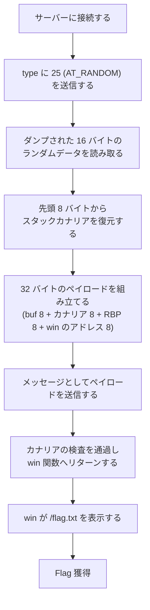

> [!IMPORTANT]
> **Solved with Gemini in Colab**
>
> この問題は Google の AI コーディングアシスタント **Gemini in Colab** を活用して解決されました。

> [!NOTE]
> この Writeup は AI により自動生成されています。 本ドキュメントは、AI アシスタントを用いて作成された Writeup です。記載内容は解法の一例であり、内容の正確性については十分にご確認の上ご利用ください。

# Auxiliary vectors are our friends

## 概要
*   **カテゴリー**: Pwn
*   **トピック**: Linux
*   **難易度**: Hard
*   **問題リンク**: [Auxiliary vectors are our friends - Daily AlpacaHack](https://alpacahack.com/daily/challenges/auxiliary-vectors-are-our-friends)

## 使用ツール
本問題を解くにあたって使用したツールは次の通りです。

*   **Python 3**: 解法スクリプトの実装
*   **pwntools**: サーバーへの接続、リーク値のパース、ペイロードの組み立て
*   **Gemini in Colab**: 配布ファイルの解析およびコード生成

## 問題の分析
本問題は、**Daily AlpacaHack** の Pwn 問題です。問題文は次の通りです。

> Linux has a concept called "auxiliary vectors"!
> （日本語版：Linuxには補助ベクトルという概念があります！）

問題ページでサーバーを起動（Spawn）すると、接続できるインスタンスが払い出されます。配布ファイルは次の通りです。

| ファイル | 内容 |
| :--- | :--- |
| `chal.c` | 問題バイナリのソースコード |
| `chal` | コンパイル済みの問題バイナリ（`gcc -o chal chal.c -no-pie`） |
| `Dockerfile` | Ubuntu 24.04 の環境で `xinetd` を使い、サーバーを TCP 1337 番ポートで公開する定義 |
| `compose.yaml` | サーバーを起動するための Docker Compose 設定 |
| `flag.txt` | フラグが書かれたファイル（サーバー上では `/flag.txt` に配置される） |

配布バイナリの性質は次の通りです。

| 項目 | 内容 |
| :--- | :--- |
| アーキテクチャ | x86-64 |
| PIE | 無効（No PIE）。実行ファイル内の関数やデータのアドレスは固定 |
| スタックカナリア | あり |
| NX | 有効 |
| RELRO | Partial RELRO |
| シンボル | あり（ストリップされていない）。`win` 関数は `0x40135f` |

なお、`win` 関数のアドレス `0x40135f` は、配布バイナリ `chal`（SHA-256: `e2538d57b32aaf6c5ff0b7d005f7bb455c6397b898b0e073b83a8cb75e2f7c1a`）における値です。`chal.c` から再ビルドした場合は、アドレスが変わる可能性があります。

プログラムの動作は、大きく 2 段階に分かれます。

**第 1 段階：auxiliary vector の問い合わせ**

`main` 関数は、まず数値 `type` を読み取り、`getauxval(type)` の戻り値を表示します。さらに、その戻り値をアドレスとして扱い、`process_vm_readv` で自プロセスのメモリから 16 バイトを読み取って、読めた場合は 16 進数で表示します。

```c
unsigned long type;
printf("type> ");
scanf("%lu", &type);
unsigned long val = getauxval(type);
printf("val: %lu\n", val);
print_hex_values_if_readable((void*)val);
```

**第 2 段階：メッセージの入力**

続いて `vuln` 関数が呼ばれ、メッセージの入力を受け付けます。

```c
void vuln(void) {
    char buf[8] = {0};
    printf("Please leave a message> ");
    fflush(stdout);
    read(STDIN_FILENO, buf, 32);
}
```

`buf` は 8 バイトしかないのに最大 32 バイトまで読み込むため、スタックバッファオーバーフローがあります。ただし、関数からのリターン時にはスタックカナリアの検査が行われるため、カナリアの値を壊すと異常終了してしまいます。

なお、`chal.c` には、フラグを表示する `win` 関数も含まれています。

```c
void __attribute__((__used__)) win(void) {
    char* argv[] = {"/bin/cat", "/flag.txt", NULL};
    execve(argv[0], argv, NULL);
}
```

ポイントは次の 3 つです。

1. `type` は任意の値を指定できるため、好きな種類の auxiliary vector を 1 回だけ問い合わせることができます。
2. 戻り値がアドレスを表す種類では、そのアドレスから 16 バイトがそのまま表示されます。
3. バイナリは No PIE のため、`win` 関数のアドレスは実行ごとに変わりません。カナリアの正しい値さえ用意できれば、リターンアドレスを `win` に書き換えられます。

## 脆弱性の詳細

### auxiliary vector と `getauxval`
auxiliary vector（auxv）は、プログラムの実行開始時にカーネルが用意するキーと値の組で、初期スタック上に引数（argv）や環境変数（envp）と並んで配置されます。動的リンクされたプログラムが、ローダやカーネルから情報を受け取るための仕組みです。glibc の `getauxval(type)` は、指定したタイプの値を返す関数です。代表的なタイプには次のようなものがあります。

| タイプ | 値 | 意味 |
| :--- | :--- | :--- |
| `AT_PHDR` | 3 | プログラムヘッダテーブルのアドレス |
| `AT_PAGESZ` | 6 | メモリページのサイズ |
| `AT_ENTRY` | 9 | プログラムのエントリアドレス |
| `AT_RANDOM` | 25 | 16 バイトのランダムデータへのポインタ |
| `AT_EXECFN` | 31 | 実行ファイル名の文字列へのポインタ |

この問題では、タイプを自由に選べることに加えて、戻り値のアドレスから 16 バイトがダンプされます。つまり、ポインタを値に持つタイプを選ぶと、その指し先の内容まで読み取ることができます。

### `AT_RANDOM` からカナリアが分かる
`AT_RANDOM`（タイプ 25）が指す 16 バイトのランダムデータは、glibc がスタックカナリアを初期化する際の元になるデータです。glibc はプロセスの開始時に、この 16 バイトの**先頭 8 バイト**を読み取り、その最下位バイトを 0 にした値をカナリアとして使います。

したがって、`type` に 25 を指定してダンプされた 16 バイトから、カナリアは次のように復元できます。

```math
\text{canary} = \text{u64}(\text{random}[0:8]) \mathbin{\&} \texttt{0xffffffffffffff00}
```

`u64(...)` は、バイト列をリトルエンディアンの 64 ビット整数として読むことを表します。最下位バイトを 0 にするのは、カナリア自体の仕様です（後述の補足を参照）。

この復元方法は、x86-64 環境の glibc が `AT_RANDOM` のデータを元にカナリアを初期化する実装に基づいています。

### カナリアを保ったままリターンアドレスを書き換える
`vuln` 関数のスタックレイアウトは次の通りです。逆アセンブルでも、`buf` が `rbp - 0x10`、カナリアが `rbp - 0x8` に置かれていることが確認できます。

| オフセット | 内容 |
| :--- | :--- |
| 0〜7 | `buf[8]` |
| 8〜15 | スタックカナリア |
| 16〜23 | 保存された RBP |
| 24〜31 | リターンアドレス |

`read` は最大 32 バイトまで読み込むため、リターンアドレスまでちょうど届きます。カナリアの位置には復元した正しい値を置くことで検査を通過し、リターンアドレスを `win` 関数のアドレス `0x40135f` に書き換えることができます。シェルコードを使うわけではないため、NX は障害になりません。

## 攻撃フロー


## 補足

<details>
<summary>補足: カナリアの最下位バイトが 0 な理由（クリックで展開）</summary>

glibc のスタックカナリアは、`AT_RANDOM` のランダムデータから生成されるランダムカナリアで、固定値を使う末端カナリア（terminator canary）とは異なります。ただし、最下位バイトは 0（ヌルバイト）にされており、文字列を扱う関数ではヌルバイトで処理が止まるため、カナリアの値が文字列経由で漏れたり上書きされたりしにくくなっています。そのため、ダンプした乱数をそのまま使うのではなく、最下位バイトを 0 に直した値が実際のカナリアになります。

</details>

<details>
<summary>補足: バイナリの CET プロパティについて（クリックで展開）</summary>

配布バイナリには、CET（Control-flow Enforcement Technology）の SHSTK と IBT のプロパティが含まれており、関数の先頭にも `endbr64` 命令が見られます。ただし、これらの機構が実際に強制されるかどうかは、CPU やカーネル、実行環境の設定に依存します。今回の問題サーバーでは、通常のリターンアドレスの書き換えで `win` 関数へ到達できました。

</details>

<details>
<summary>補足: 他のタイプを指定した場合（クリックで展開）</summary>

問い合わせは 1 回しかできないため、タイプの選択が重要です。アドレスではない値を持つタイプ（`AT_PAGESZ` など）を選ぶと、その値自体がアドレスとして解釈され、ほとんどの場合は読み取りに失敗して「not readable」と表示されます。`AT_RANDOM` を選ぶのが本問題の要点ですが、他のポインタ系のタイプでも指し先の 16 バイトを読み取ること自体は可能です。

</details>

> [!WARNING]
> この問題の本質は、**防御機構の秘密そのものが、正規の機能を通じて漏れてしまう**点にあります。スタックカナリアは「攻撃者にはカナリアの値が分からない」ことを前提に動作しますが、その元になる乱数を読み取る手段が用意されていると、カナリアによる検査は形だけのものになってしまいます。実システムでは、メモリの内容を読み取って表示するようなデバッグ用途の機能は、秘密情報への到達可能性まで含めて慎重に扱う必要があります。

## 用語解説
*   **auxiliary vector（auxv）**: プログラムの実行開始時に、カーネルが初期スタック上に用意するキーと値の組です。ページサイズやランダムデータの場所など、プロセスに関する情報が格納されます。
*   **`getauxval`**: glibc の関数で、指定したタイプの auxiliary vector の値を返します。
*   **`AT_RANDOM`**: auxiliary vector のタイプの 1 つ（値 25）で、16 バイトのランダムデータへのポインタを表します。このランダムデータは、スタックカナリアの生成にも使われます。
*   **スタックカナリア**: 関数のスタックフレームに置かれる検証用の値です。関数から戻る際に値が変わっていないか検査され、バッファオーバーフローによる書き換えを検出します。
*   **バッファオーバーフロー**: 確保した領域を超えてデータを書き込むことで、隣接するデータを上書きする脆弱性・攻撃です。
*   **`process_vm_readv`**: 指定したプロセスのメモリを読み取るためのシステムコール／ライブラリ関数です。この問題では自プロセスのメモリを読むために使われています。
*   **No PIE**: バイナリが位置独立実行形式ではなく、読み込みアドレスが固定であることを指します。関数のアドレスが実行ごとに変わらないため、アドレスのリークなしに狙った関数へ飛ばすことができます。
*   **ret2win**: バッファオーバーフローでリターンアドレスを書き換え、プログラム内に用意された「勝利関数」（この問題では `win`）へ処理を移す、Pwn の基本的な攻撃パターンです。

## 解決スクリプト
[solve.py を参照してください](./solve.py)

```bash
python3 solve.py <HOST> <PORT>
```

問題ページでサーバーを起動（Spawn）すると、接続先のホストとポートが表示されます。それらを引数に指定して実行してください。実行には pwntools が必要です。
